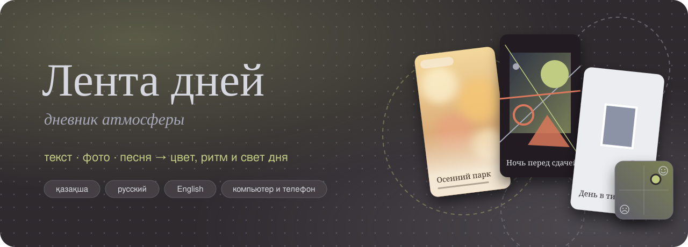
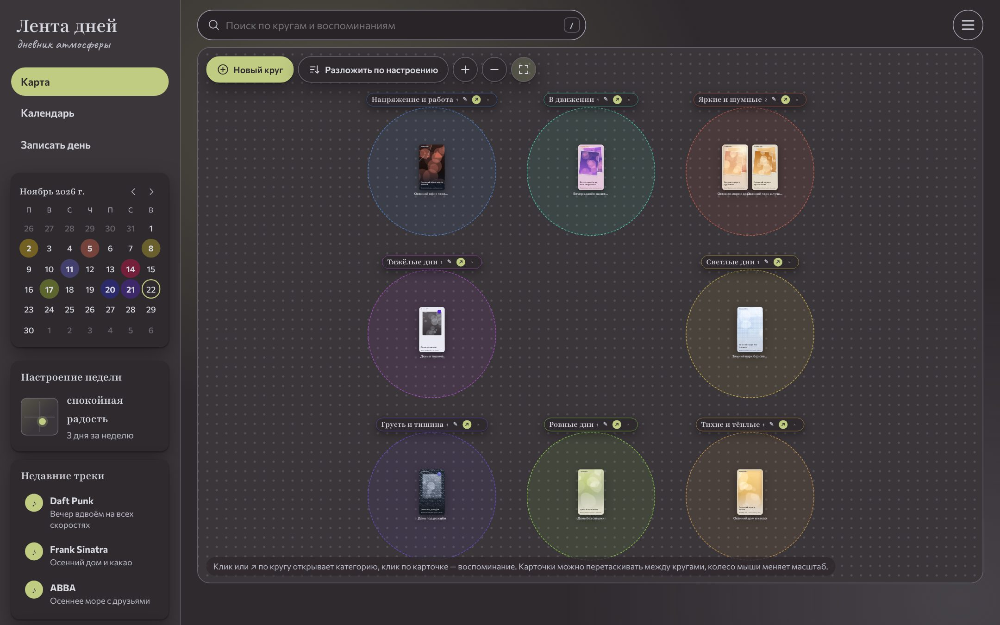
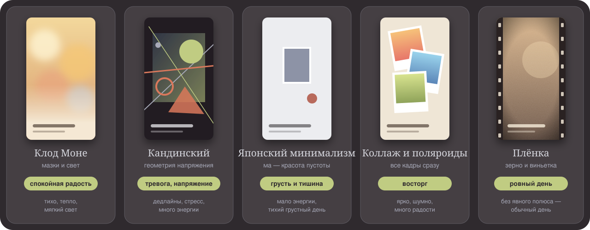
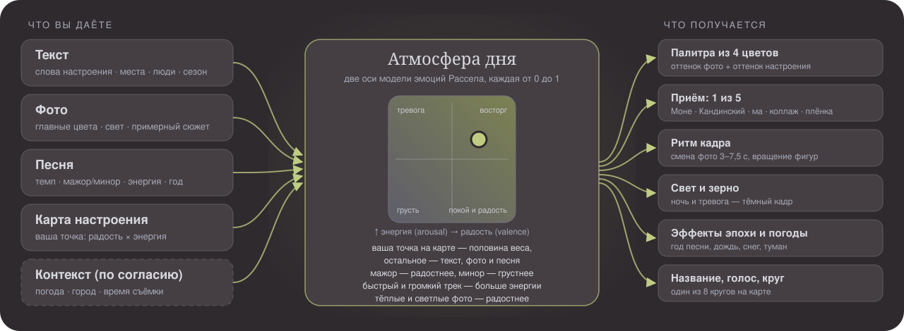
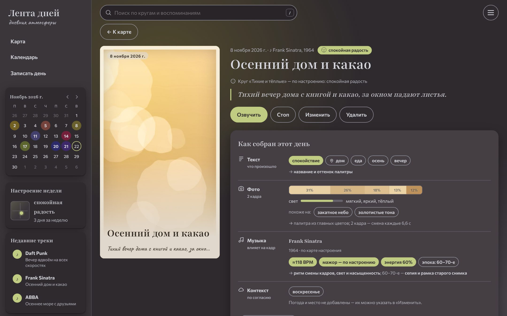
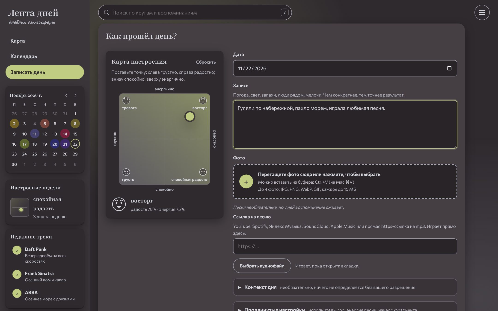
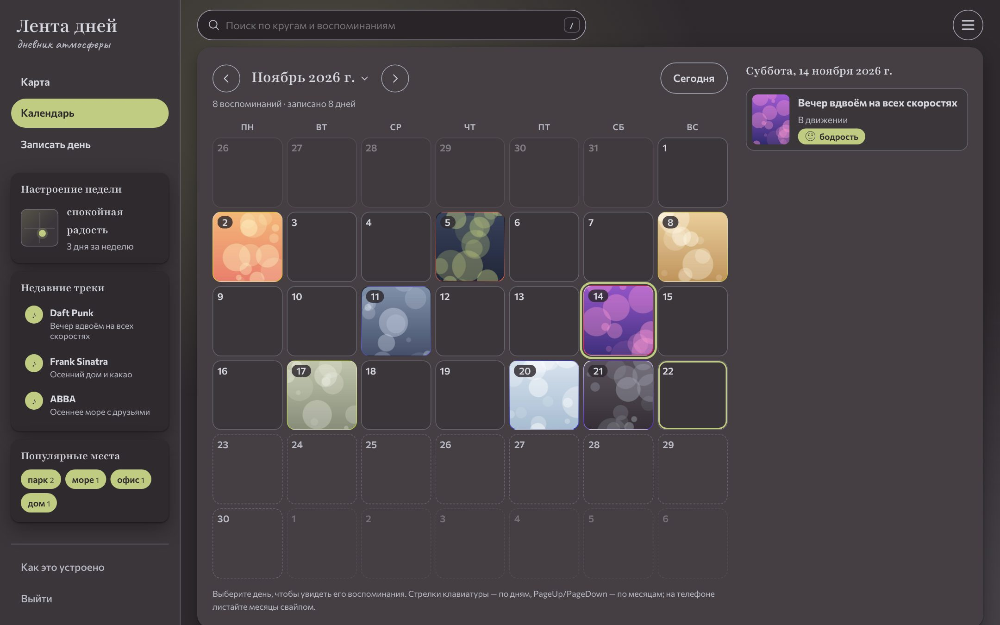
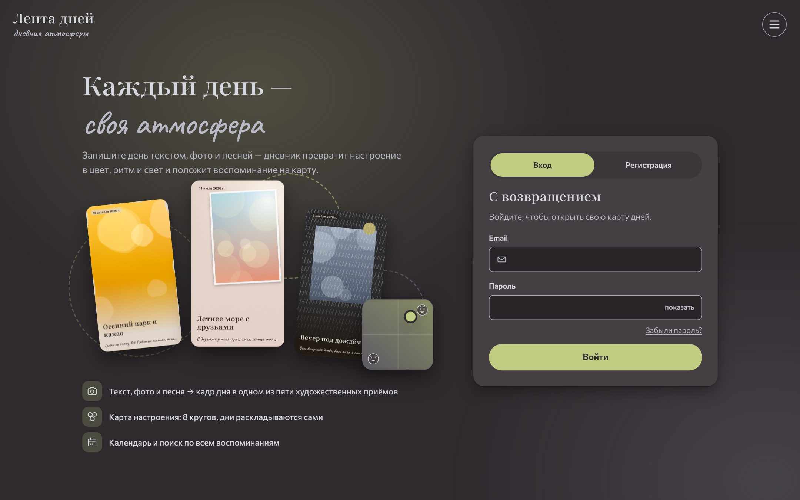
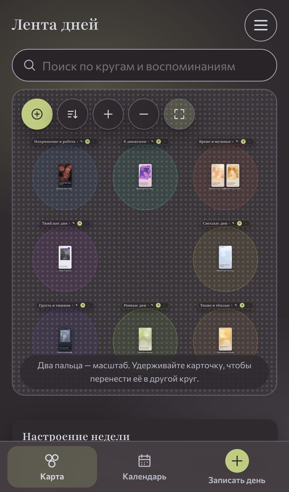
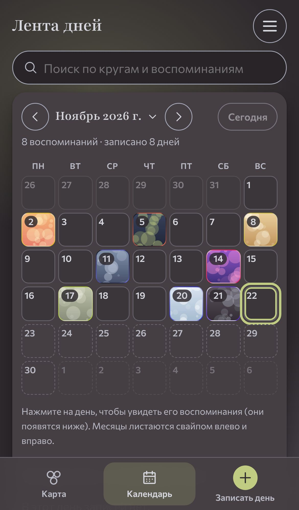

**Запишите день текстом, фото и песней — «Лента дней» превратит его настроение в картину: цвет, ритм, свет и художественный приём — и положит воспоминание на карту.**

қазақша · русский · English · компьютер и телефон

 

 

## 1. Художественные приёмы

Каждый день превращается в вертикальный кадр 9:16, нарисованный в одном из пяти приёмов. Приём выбирается автоматически по **атмосфере дня**: две оси — **радость** (грустно ↔ радостно) и **энергия** (спокойно ↔ энергично), каждая от 0 до 1. Подробнее о том, как считается атмосфера, — во втором разделе.

| Приём | Референсы | Для каких настроений | Как выглядит кадр |
|---|---|---|---|
| **Клод Моне: мазки и свет** | импрессионизм; Клод Моне — «Впечатление. Восходящее солнце», «Кувшинки» | **спокойная радость**: тихо, тепло (энергия < 0,55, радость ≥ 0,45) | фото «расплываются» акварельным смещением, поверх мягкий цветной свет, много воздуха |
| **Кандинский: геометрия напряжения** | абстракционизм и Баухаус; Василий Кандинский — «Композиция VIII», «Несколько кругов» | **тревога и напряжение**: дедлайны, стресс, много энергии (слова о напряжении или «тревога» на карте настроения и энергия > 0,45) | фото в двух тонах, поверх вращаются линии, круги и треугольники; чем выше энергия, тем быстрее вращение; акцент — дополнительный цвет |
| **Японский минимализм: ма (пустота)** | эстетика *ма* и *ваби-саби*, энсо; Хасэгава Тохаку — «Сосновый лес» | **грусть и тишина**: тихий грустный день (радость < 0,4 и энергия < 0,5) | один кадр в маленькой рамке, много пустого места, один акцентный круг, почти без зерна |
| **Коллаж и поляроиды** | фотоколлажи-«джойнеры» Дэвида Хокни, снимки Polaroid | **восторг**: ярко, шумно, весело (энергия > 0,62 и радость > 0,5) | все фото дня лежат одновременно с наклоном, как снимки на столе |
| **Плёночная фотография** | аналоговая 35-мм плёнка, эстетика репортажного снимка и ломографии | **ровный день** без явного полюса: всё, что не попало в другие приёмы | густое зерно, выцветшая тёплая обработка, виньетка |

**Дополнительные слои поверх приёма**

| Слой | Когда | Эффект и референс |
|---|---|---|
| Эпоха песни: до 60-х | год песни < 1960 | монохром и густое зерно — чёрно-белая фотография середины века |
| Эпоха: 60–70-е | 1960–1979 | сепия и белая рамка старого отпечатка |
| Эпоха: 80-е | 1980–1989 | неоновый дуотон и строки развёртки — VHS, синтвейв |
| Эпоха: 90-е | 1990–1999 | плёнка и дата в углу — плёночная «мыльница» |
| Эпоха: 2000-е | 2000–2009 | цифровая «мыльница» и оранжевая дата |
| Погода (по согласию) | дождь, гроза, снег, туман, облачно, ясно | капли или хлопья на кадре, дымка, приглушённые цвета или солнечный блик; палитра становится холоднее или теплее |
| Время суток | ночь, тревога или грусть | тёмный кадр (светлота фона 11 % вместо 84 %) |

**Круги на карте** — те же оси, разделённые на 8 секторов по 45° (по модели эмоций Рассела): «Яркие и шумные» (восторг), «В движении» (бодрость), «Напряжение и работа» (тревога), «Тяжёлые дни» (тоска), «Грусть и тишина», «Ровные дни» (спокойствие), «Тихие и тёплые» (спокойная радость), «Светлые дни» (радость). Свои круги пользователь создаёт сам: круг с понятным названием («Работа», «Море», «Осень») собирает подходящие дни, а круг с любым другим названием учится на воспоминаниях, которые в него положили.

 

## 2. Описание

**Идея.** Обычный дневник хранит факты: что было и где. «Лента дней» хранит **атмосферу**: каким был день по ощущению. Пользователь пишет пару строк, добавляет фото и песню, ставит точку на карте настроения — и получает не запись, а маленькую картину дня. Воспоминания складываются в карту из кругов-настроений и в календарь, поэтому за месяц видно, каким он был: светлым, тревожным или ровным.

**Аудитория.** Подростки и молодые люди 16–30 лет, которые фотографируют, слушают музыку и хотят вести дневник, но не готовы писать много: студенты, творческие люди, все, кому важно замечать своё настроение. Интерфейс на казахском, русском и английском, удобен на телефоне.

**Правила визуальной системы.**

- **Палитра дня** — 4 цвета. Оттенок смешивает главный цвет фото (вес 0,55, если фото насыщенное) с оттенком настроения: покой 28°, радость 45°, энергия 8°, напряжение 215°, грусть 228°. Насыщенность = 28 % + 40 % × энергия + 15 % × радость. Акцент сдвинут на 20° (у Кандинского — на 150°, дополнительный цвет).
- **Ритм**: фото сменяются каждые 7,5 − 4,5 × энергия секунд (от 3 до 7,5 с); фигуры Кандинского делают оборот за 40 − 25 × энергия секунд.
- **Фактура**: зерно у плёнки 0,45, у минимализма 0,08, у остальных 0,15 + 0,15 × энергия.
- **Голос** озвучки: скорость 0,82 + 0,3 × энергия, высота 0,95 + 0,2 × радость.
- **Интерфейс** строится только из токенов: две палитры («Тёплая» и «Олива»), светлая и тёмная тема, контраст текста по WCAG. Шрифты: Playfair (заголовки), Commissioner (текст), Caveat (подписи «от руки»). Все значки и лица настроения — векторные, без эмодзи.

**Как текст, фото и музыка влияют на результат.**

- **Текст** разбирается словарями на трёх языках: пять настроений (покой, энергия, напряжение, грусть, радость), места, люди, события, сезон и время суток. Отсюда — оттенок палитры, тёмный или светлый кадр и автоназвание («Осенний дом и какао»).
- **Фото**: главные цвета (кластеризация k-means), свет и контраст, примерный сюжет (небо, зелень, вода, снег, закат). Характерный цвет становится основой палитры; тёплые и светлые фото делают день радостнее, несколько кадров — чуть энергичнее.
- **Музыка** — главный источник ритма. Темп, мажор или минор и энергия берутся из самого звука (свой аудиофайл или 30-секундный фрагмент песни по ссылке) и из открытых данных Deezer. Быстрый и громкий трек поднимает энергию, мажор добавляет радости, минор убавляет; год песни включает эффект эпохи.
- **Карта настроения** — личная оценка дня; она весит половину и решает, в какой круг попадёт день.
- **Контекст** (только по согласию): погода за эту дату сдвигает палитру и добавляет эффект на кадр, город и время съёмки уточняют название.

Всё считается в браузере по формулам и словарям — без ИИ и без отправки текста на сервер. Панель «Как собран этот день» в каждой записи показывает, что именно на что повлияло.

<table>
  <tr>
    <td width="50%"></td>
    <td width="50%"></td>
  </tr>
  <tr>
    <td width="50%"></td>
    <td width="50%"></td>
  </tr>
</table>

&nbsp;&nbsp;

 

## Возможности

- **Запись дня**: текст, до 4 фото (перетаскивание, вставка из буфера), песня по ссылке или своим файлом, карта настроения, контекст по согласию
- **Кадр дня 9:16** в одном из пяти приёмов + эффекты эпохи и погоды, озвучка записи
- **Карта воспоминаний**: 8 кругов настроения и свои круги, перенос карточек, масштаб двумя пальцами
- **Календарь** и **поиск** по кругам и воспоминаниям
- **Вход и регистрация**, восстановление и смена пароля
- Три языка, две палитры, светлая и тёмная тема, компьютер и телефон

## Безопасность

- Защита на уровне базы (RLS) «только владелец»: свои записи видит только автор; каждый запрос дополнительно ограничен его `user_id`
- Строгая CSP без `unsafe-inline` / `unsafe-eval`, защита от встраивания на чужие сайты, HSTS — в [`vercel.json`](vercel.json)
- Ссылки на песни — только по белому списку, плееры в `sandbox`; файлы проверяются по сигнатуре, фото пережимаются без EXIF и геометок
- Серверная функция `music-meta` обращается только к фиксированным адресам и проверяет вход
- Координаты не сохраняются, погода и место — только после включения переключателя

## Библиотеки, готовые ресурсы, API и AI-инструменты

**Библиотеки** — хранятся в [`vendor/`](vendor/) с зафиксированными версиями, без CDN ([лицензии](vendor/LICENSES.md)):

- [React](https://react.dev) 18.3.1 и ReactDOM 18.3.1 — интерфейс (MIT)
- [htm](https://github.com/developit/htm) 3.1.1 — JSX-подобная разметка без сборщика (Apache-2.0)
- [supabase-js](https://github.com/supabase/supabase-js) 2.45.4 — вход и работа с базой (MIT)

**Шрифты** — хранятся в [`fonts/`](fonts/), SIL Open Font License 1.1: Playfair, Commissioner, Caveat.

**Платформы:** [Supabase](https://supabase.com) — вход, PostgreSQL с RLS, Edge Functions (Deno); [Vercel](https://vercel.com) — хостинг и заголовки безопасности.

**Внешние API** — вызываются только по действию пользователя:

- [Open-Meteo](https://open-meteo.com) — поиск города, погода за дату и архив (данные CC BY 4.0)
- [BigDataCloud](https://www.bigdatacloud.com) — название города по округлённым координатам
- oEmbed [YouTube](https://www.youtube.com), [Spotify](https://open.spotify.com), [SoundCloud](https://soundcloud.com) — название трека по ссылке
- [iTunes Search API](https://performance-partners.apple.com/search-api) — исполнитель, год, жанр, обложка
- [Deezer API](https://developers.deezer.com) — темп, громкость и 30-секундный фрагмент для анализа (фрагмент не сохраняется)
- Встраиваемые плееры: YouTube, Spotify, Яндекс Музыка, SoundCloud, Apple Music

**Возможности браузера:** Web Audio API (декодирование и анализ звука), Canvas 2D (обработка фото, удаление EXIF), Web Speech API (озвучка), Geolocation API (по согласию), Intl (даты и числа на трёх языках).

**Готовые методы и модели**, на которых построен анализ (реализованы в проекте с нуля):

- модель эмоций Рассела (circumplex model of affect, 1980) — карта настроения и 8 кругов
- кластеризация k-means — главные цвета фото
- спектральный поток SuperFlux (Böck, Widmer, 2013) и обобщённая автокорреляция (Percival, Tzanetakis, 2014) — темп
- профили тональностей Sha'ath (KeyFinder, 2011) и Krumhansl–Kessler — мажор и минор

**Готовые ресурсы:** стоковых изображений нет. Иконки, лица настроения, иллюстрации README — свои, векторные; демо-картинки генерируются кодом. Для проверки анализа звука использовались открытые примеры записей из наборов [librosa](https://librosa.org) и [Essentia](https://essentia.upf.edu); в проект они не входят. Автотесты — [Playwright](https://playwright.dev) с Chromium.

**AI-инструменты:** [Claude](https://claude.ai) (Anthropic) в Claude Code — аудит безопасности, архитектура, код, тесты, тексты на трёх языках, этот README. Сам сайт ИИ не использует: анализ текста, фото и звука и раскладка по кругам — формулы и словари, которые работают в браузере.
